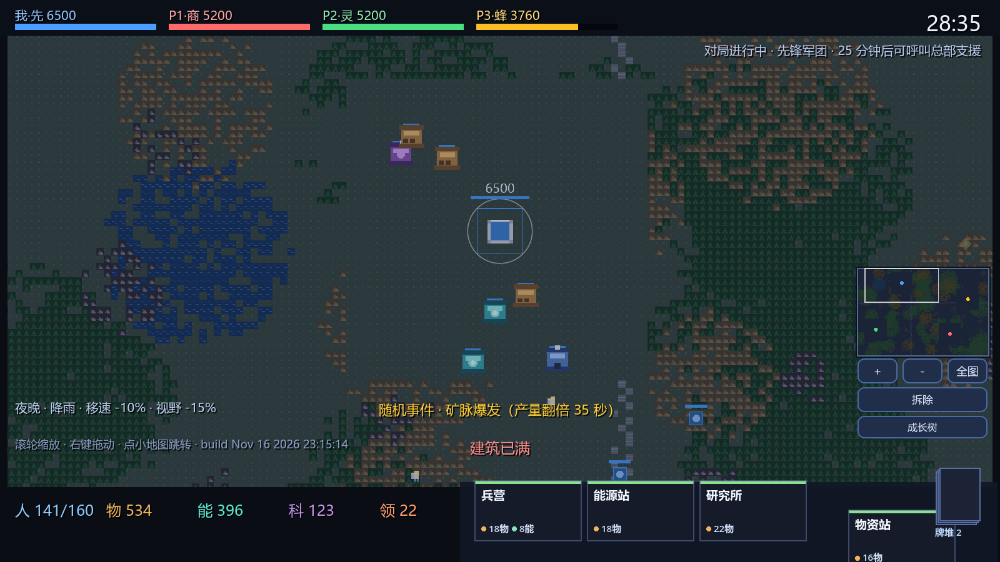

# kingdom_fight · 4 人实时 RTS + 卡牌构筑（C++ 服务端 / Godot 2D 客户端）

> 四家星际联盟抢一颗星球的四个随机降落点：先运营（人力 / 物资 / 能源 / 科技 / 领地），
> 再用兵营滚出兵、用工程兵开路、用卡牌盖建筑和放法术，把对面家拆了。
> **服务端权威**：合法性、伤害、胜负全在 C++20 里算；Godot 只负责画和收意图。
> 确定性模拟（全整数、固定种子），同输入必得同结果。



C++20 · 20Hz 实时 · 4800×3200 像素地图（240×160 格）· 5 种资源 · 40 张卡 · 昼夜与天气 ·
自定义二进制协议 · 零第三方依赖 · **130 个 C++ 单测 + 107 项客户端断言（51 协议 + 56 快照）**

## 跑起来

1. 双击 `run-demo.cmd`，等窗口打开（**服务端直接跑在本机 Windows 上**，第一次会先编一次，约 1~2 分钟，之后 2 秒内起来）。
2. **开始页**：点一个阵营（中间会列出它的 10 张牌），点「开始游戏」。
3. **构筑界面**：选 8 张牌（或「一键选推荐」）、可选兵营默认兵种，点「开始对局」。

难度可以选：

```powershell
.\demo.ps1 -AiLevel easy     # 也可以 hard
.\demo.ps1 -Wsl              # 旧路线：服务端放进 WSL 跑（走真正的 epoll）
```

> **为什么用 `run-demo.cmd` 而不是直接跑 `.\demo.ps1`？**
> 这台机器 PowerShell 执行策略会拦未签名脚本，`run-demo.cmd` 只是用 `-ExecutionPolicy Bypass`
> 启动同一个脚本（只对这一条命令生效，不改系统设置）。
>
> 历史上服务端只能跑在 WSL 里（据说是 Device Guard 拦未签名 exe）。2026-11-17 复核：
> 本机直接跑没问题，所以默认路径改成了原生 Windows；WSL 那条留着 `-Wsl` 备用。

## 玩法要点

| 系统 | 说明 |
|---|---|
| **资源** | 人力 / 物资 / 能源 / 科技 / 领地，五种。领地不是产出，是"占了多少格" |
| **出兵** | **兵种不由卡牌召唤**：兵营按兵种各自的训练时间（民兵 5 秒 ~ 加农炮 20 秒）自动训练一个（花人力和物资），兵种由阵营或你的 DIY 选择决定；工程站每 7 秒出一个工程兵 |
| **建造** | 建筑落地先是个**工地**（12 秒、只有 30% 血），完工前不产出；工程兵在旁边能加速 50%/个 |
| **工程兵** | 每 4 秒清掉身边一格森林/岩石（打通近路）；顺手维修 160px 内受损建筑 |
| **卡牌** | 每家 10 张（4 建筑 + 防御塔 + 工程站 + 开路 + 3 法术）；**卡组 8 张、同卡最多 2 张**，手牌 4 张循环；**右键手牌弃牌**换下一张防卡手 |
| **领地** | 开局基地周围半径 240px 的圆，四家一样大；占资源点向外扩张 |
| **建筑上限** | `clamp(4 + 领地/10 + 经济枢纽, 4, 11)` —— 领地越大能盖的越多，点出「工业枢纽」再 +1 |
| **防御塔** | 只能盖在**自家领地 + 可建造空地（平地/道路）**上，彼此至少隔 120px |
| **成长树** | 三棵树（军政/经济/工程），每棵「根 → 两条互斥分支 → 终局节点」；后期节点需要别的树做前置（例：工业枢纽要军政的训练加速，给建筑上限 +1） |
| **总部支援** | 25 分钟后可呼叫对地打击（需要 15 点领地，领地是"按格子算"的派生值，所以这实际是一道门槛） |
| **随机事件** | 补给空投 / 矿脉爆发（产量翻倍），开局 60 秒后每 75 秒一次 |
| **昼夜天气** | 2 分钟一个昼夜循环；雨/雾/风暴影响移速 |

## 操作

| 操作 | 说明 |
|---|---|
| 点手牌 → 点地图 | 放建筑/法术。鼠标悬停会显示地形属性（森林 -30%、水域不可通行…） |
| 滚轮 / 右键拖动 | 缩放（1.0~4.0）· 平移视角（没有小地图，用「全图」按钮回到全局） |
| 「拆除」 | 打开后点自家建筑/塔就拆（拆塔直接释放上限，基地本身有防守火力） |
| 「修复」 | 打开后点自家受损建筑/塔，按缺失血量花物资补满 |
| 底部工具栏 | 资源/基地/建筑/计时都在这里；成长树、拆除、修复、总部支援、缩放都是工具栏按钮 |
| 放置预览 | 建筑/塔占**固定 4×4 格方块**，预览整块绿/红（地形 + 领地掩码 + 重叠 + 塔上限，和服务器同一套判定）；法术按真实半径显示作用范围 |
| 防御塔 | 工具栏「造塔」（不占卡组）：先工地 → 完工才开火；固定槽位 `1 + 领地/90`（「要塞」+1，最多 3 座），70 物 + 30 能 |
| 资源片区 | 地图固定生成 20 个片区（4 城市 + 4 高资源 + 12 普通），均匀铺开、中心清出广场；占领后把一圈并进领地，领地越多产量越高（+2%/点，封顶 +80%） |
| 城镇据点 | 原星球守军中立据点：2400 血核心 + 固定炮台（只防守不主动出击），打掉核心再站 10 秒才能占 |
| 攻城兵 | 冲车/投石车/弩炮/加农炮：普通兵对建筑 35%，攻城兵 300%，攻城兵打兵只有 40% |
| 领地按钮 | 工具栏「领地」：把自家领地按 4×4 格铺在地图上 |
| 手牌 | 平时只露上半部分，鼠标移上去自动升起 |
| 建筑详情 | 左键点自家建筑/塔：血量、建造进度、攻击区域；兵营可逐个切换训练兵种（不同兵种训练时间不同），还能指定攻击区域 |
| `ESC` | 暂停（继续 / 返回主菜单 / 退出） |
| `M` | 静音开关 |

## 四个阵营

| 阵营 | 被动 | 兵营训练 | 特色法术 |
|---|---|---|---|
| 先锋军团 | 建筑与塔 +25% 血量 | 盾卫（重装） | 轨道炮击 / 壁垒号令 / 应急治疗 |
| 联合商会 | 物资产出 +25% | 骑手（机动） | 火雨 / 应急治疗 / 冰霜 |
| 灵能教团 | 能源 +40%、科技 +25% | 弓手（远程） | 冰霜 / 火雨 / 应急治疗 |
| 蜂群 | 人力上限 +50、恢复更快 | 民兵（数量） | 战吼 / 应急治疗 / 冰霜 |

## 数值基线（bench，900 秒上限，12 局，固定种子）

```
平均 298.7 秒；首次淘汰 144.1 秒；91.7% 打到只剩一家（1 局撞 900 秒上限）
结束时平均占领资源点 5.1 / 20；平均领地 24 / 家；总部支援平均呼叫 11.6 次
联盟胜率：先锋 38.5% / 教团 23.1% / 蜂群 22.2% / 商会 7.7%（样本小，只看趋势）
```

> 复现（固定种子，跑两遍应该逐字节一致）：
> `.\build\bin\kingdom_fight_bench.exe --matches 12`（Windows）/
> `./build-linux/kf_bench --matches 12`（WSL）
>
> 数值集中在 `src/rts/types.h` 和 `src/rts/cards.cpp`，改完跑一遍就能看节奏变化。
>
> **上一版基线是 579.7 秒 / 只有 50% 打到只剩一家**：根因不是数值大小，而是总部支援
> 的价格存在两个地方 —— `MatchConfig::hq_cost_territory` 硬编码 30，注释还写着
> "同 kHqCostTerritory"，于是改那个常量完全不生效。领地是按格子重算的派生值，
> 开局和收官都在 21 上下，够不到 30，号称"僵持局结束手段"的总部支援从没被用上。
> 统一成一处定义、门槛降到 15 之后，僵持局能被真正结束。
>
> CI 用 `--check --max-avg-seconds 480 --max-timeout-percent 30` 兜一道下限保险，
> 接住"僵持局又回来了"这种回退。

## 项目结构

完整目录说明（"我要改 X 该动哪里"对照表）见 **[docs/PROJECT_LAYOUT.md](docs/PROJECT_LAYOUT.md)**。

```
src/rts/     模拟内核（types.h 数值 / sim.cpp 规则 / cards.cpp 卡牌 / terrain.cpp 地图 / ai.cpp AI）
tools/       服务端入口、跑分、占位美术/音效生成、各种探针
client/godot 表现层（main.gd 总控 / board.gd 战场 / card_view.gd 卡牌 / audio.gd 音效）
tests/       130 个 C++ 单测
docs/        设计文档、ADR、试玩清单
```

## 美术与音效（可逐张替换）

- 占位资源是**脚本生成的**：`python tools/gen_art.py`、`python tools/gen_sfx.py`
- 命名规范、画布尺寸、替换步骤：**[client/godot/assets/README.md](client/godot/assets/README.md)**
- 关键：替换完 PNG/WAV 后要跑一次
  `godot --headless --editor --quit --path client/godot` 生成 `.import`，否则运行时读不到
- 缺图 → 回退色块；缺音效 → 静音。都不会崩

## 开发与自检

```powershell
# C++ 编译 + 130 个单测（两条路，跑的是同一批源码）
powershell -ExecutionPolicy Bypass -File build.ps1 test        # Windows，MSYS2 UCRT64 g++
wsl bash -lc "cd /mnt/d/Code/DSH/*Game* && ./build.sh test"    # WSL / Linux，真 epoll 那条路径

# 服务端端到端（真实 TCP，不需要 Godot）：起服务端 → python 客户端断言协议
wsl bash -lc "cd /mnt/d/Code/DSH/*Game* && ./build.sh smoke"

# 平衡/节奏跑分（12 局，带节奏门禁）
wsl bash -lc "cd /mnt/d/Code/DSH/*Game* && ./build.sh bench 12"

# 客户端协议测试（51 项帧格式 + 56 项快照断言 + 美术加载）
bash tools/run_godot_tests.sh                                  # 自己找 Godot，找不到会明确 skip

# 完整手测清单
notepad docs/PLAYTEST_CHECKLIST.md

# 开发用参数
godot --path client/godot -- --autodeck --bot --port=9700   # 直接开局、机器人代打
godot --path client/godot -- --show-growth                   # 直接看成长树整页
godot --path client/godot -- --show-result                   # 直接看结算页
```

## 已知限制

- 工程兵只清森林/岩石，**不会填水**，也不会规划路线（就近清）。
- 玩家不能手动指挥工程兵去某处（修复已经可以做：右侧「修复」开关）。
- 局外 DIY 只存在本机 `user://profile.json`，没有多套方案。
- `main.gd` 仍然偏大；成长树页已经拆到 `scripts/growth_page.gd`，构筑界面和结算页待拆。

## 文档索引

- [项目结构与维护指南](docs/PROJECT_LAYOUT.md)
- [试玩自检清单](docs/PLAYTEST_CHECKLIST.md)
- [试玩自检报告（含整局证据）](docs/PLAYTEST_REPORT.md)
- [美术资源规范](client/godot/assets/README.md)
- 架构决策：`docs/adr/`（地图、协议、表现层、寻路、节奏、成长树等）
- 逐轮改动记录：[CHANGELOG.md](CHANGELOG.md)
