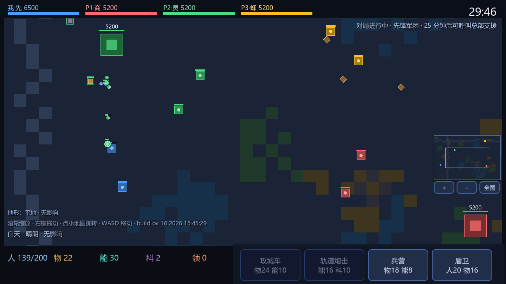

# Godot 2D 客户端（表现层）

> 这个工程只做三件事：**把服务端下发的地图与快照渲染成画面、把玩家的点击打包成指令、播结算界面。**
> 规则判定 / 随机数 / 状态权威 / 胜负计算——一行都没有（ADR 0002 护栏二）。
>
> 判断标准：把这个目录整个删掉，服务端是否仍然完全正确？**是**。



## 在编辑器里为什么看不到画面

`Main.tscn` 只有一个 `Control` + 脚本，**没有任何可见子节点** —— 战场、HUD、开始页、构筑界面
全部是 `main.gd` 在运行时用代码创建/绘制的，而编辑器**不执行 `_ready()`、也不跑 `_draw()`**。
所以在 Godot 里打开这个场景，2D 视图看上去就是空的（严格说是"一块透明的全屏 Control"）。

为了让编辑器里不至于两眼一抹黑，场景里放了一个 `EditorPlaceholder`（深色底 + 一行说明），
运行时 `main.gd` 的第一件事就是把它 `queue_free()` 掉。

**要看到真正的画面**：先起服务端（卡池/地图都是服务端下发的，没有它会停在「未连接服务端」），
再运行客户端；或者直接在仓库根目录双击 `run-demo.cmd`（服务端 + 客户端一起起）。

```powershell
# 服务端（WSL）
wsl bash -lc "cd /mnt/d/Code/DSH/*Game* && ./tools/serve_wsl.sh 9700"
# 客户端
godot --path client/godot
```

## 渲染约定

- 世界坐标是 **2400×1600**（和 `src/rts/types.h` 一致），窗口是 1600×900。
  `board.gd` 用 `draw_set_transform` 统一缩放居中，鼠标坐标用同一个 `_scale/_offset` 反算回去。
- 地图**不自己生成**：服务端用 `S2C_Map` 发 30×20 的格子 + 本局四个降落点坐标，客户端只负责上色。
- 四家四种颜色（蓝/红/绿/黄），顶部四格血条 + 姓名。
- 底部四资源计数：兵（带上限）/ 食 / 铁 / 科；卡面显示多资源价格（"兵10 食8"）。
- 建筑按类型上色：农场绿、矿井灰、兵营蓝、研究所紫。

## 跑起来

```powershell
# 先起服务端（在仓库根目录）
.\demo.ps1

# 或者分开：WSL 起服务端 + 单独开客户端
godot --path client/godot
```

## 操作

| 操作 | 说明 |
|---|---|
| 点手牌 / 按 `1`–`4` | 选卡 |
| 点战场 | 落点（单位只能放己方半场，法术任意） |
| `Esc` | 取消 |

## 目录

```
client/godot/
├── project.godot          1600×900，canvas_items 拉伸；UI 和世界共用一套坐标
├── scenes/Main.tscn       只有一根骨架节点，界面全部由 main.gd 建出来
├── scripts/
│   ├── kf_protocol.gd     帧编解码（纯函数，不碰 socket）
│   ├── kf_net.gd          StreamPeerTCP 轮询 + 喂字节 + 派发消息
│   ├── board.gd           战场绘制（_draw）+ 点击换算成世界坐标
│   └── main.gd            连接 / 构筑 / 对局 / 结算 的状态机
└── tests/
    ├── golden_frames.txt  协议契约向量（C++ 侧读同一份）
    └── test_decoder.gd    脱网协议测试，headless 跑
```

## 调试参数（`--` 之后的都是自定义参数）

```powershell
godot --path client/godot -- --autodeck          # 自动选前 6 张，跳过构筑
godot --path client/godot -- --autodeck --bot    # 再让客户端自己出牌（演示/录屏）
godot --path client/godot -- --autodeck --selftest   # 合成一次鼠标点击，验证"选牌→点战场→回执"
godot --path client/godot -- "--shot=D:\a.png" "--shot-delay=20"   # 20 秒后截图并退出
godot --path client/godot -- "--server=172.27.72.9"               # 连别的地址
```

`--selftest` 不是摆设：它抓出过一个真 bug——根 `Control` 默认 `MOUSE_FILTER_STOP`，
会把整屏鼠标事件吃掉，导致"能选牌、点战场没反应"。

## 三条规矩（详见 docs/adr/0002-godot-client.md）

1. **解码器是纯函数，不碰 socket。** `StreamPeerTCP` 只负责 `poll()` + `get_partial_data()`。
2. **大端读取只有 `KFProtocol._be16/_be32` 两个入口。** 禁止 `PackedByteArray.decode_u16/u32/u64`
   —— Godot 的 `decode_*` 默认小端，和协议相反。CI 有 grep 检查。
3. **golden 向量是唯一契约。** 改帧格式 = 同时改 `src/net/protocol.h`、`kf_protocol.gd`、
   `tests/golden_frames.txt` 三处。

## 协议测试（不需要编辑器、不需要服务端）

```powershell
godot --headless --path client/godot --script res://tests/test_decoder.gd
```

当前 51 项：golden 解码 / 重编码逐字节一致 / 粘包 / 逐字节半包 / 失败态锁定。
